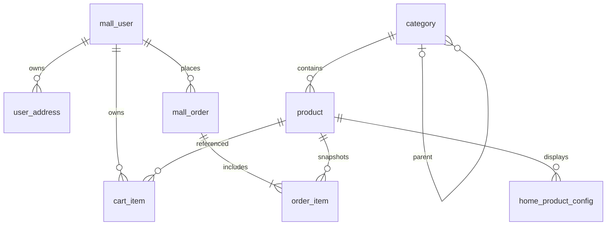

# 01电商系统 数据关系与字段说明

版本：V001。这是 A 牵头提交的开发基线，B/C 需复核后共同采用。唯一可执行结构为 `src/main/resources/db/V001__schema.sql`，本文件逐项列出同一版本字段。

## 表关系

共 10 张业务表和 1 张版本表。`admin_user`、`carousel` 独立。分类根节点 parent_id 为 NULL，子分类引用父分类，三级目录由 B 的服务层校验。订单必须至少一项由 C 的事务保证，数据库外键只约束归属，不自动保证明细数量。

## 字段与约束

主键为 BIGINT 自增，JSON 输出 ID 时前端避免超出 JavaScript 安全整数范围；后续接口序列化需统一字符串 ID。数据库时间使用 Asia/Shanghai 约定；created_at 仅插入时默认当前时间，updated_at 在修改 SQL 中显式赋 CURRENT_TIMESTAMP。

### schema_version

维护责任：A 公共基线。

| 字段 | 类型及数据库约束 |
| --- | --- |
| `version` | `VARCHAR(20) PRIMARY KEY` |
| `description` | `VARCHAR(200) NOT NULL` |
| `installed_at` | `TIMESTAMP NOT NULL DEFAULT CURRENT_TIMESTAMP` |

### mall_user

维护责任：A。

| 字段 | 类型及数据库约束 |
| --- | --- |
| `user_id` | `BIGINT AUTO_INCREMENT PRIMARY KEY` |
| `login_name` | `VARCHAR(32) NOT NULL UNIQUE` |
| `password_hash` | `VARCHAR(255) NOT NULL` |
| `nickname` | `VARCHAR(40) NOT NULL` |
| `phone` | `VARCHAR(20)` |
| `status` | `TINYINT NOT NULL DEFAULT 0 CHECK (status IN (0,1))` |
| `created_at` | `TIMESTAMP NOT NULL DEFAULT CURRENT_TIMESTAMP` |
| `updated_at` | `TIMESTAMP NOT NULL DEFAULT CURRENT_TIMESTAMP` |

### user_address

维护责任：A。

| 字段 | 类型及数据库约束 |
| --- | --- |
| `address_id` | `BIGINT AUTO_INCREMENT PRIMARY KEY` |
| `user_id` | `BIGINT NOT NULL` |
| `receiver_name` | `VARCHAR(40) NOT NULL` |
| `receiver_phone` | `VARCHAR(20) NOT NULL` |
| `province` | `VARCHAR(40) NOT NULL` |
| `city` | `VARCHAR(40) NOT NULL` |
| `district` | `VARCHAR(40) NOT NULL` |
| `detail_address` | `VARCHAR(200) NOT NULL` |
| `is_default` | `TINYINT NOT NULL DEFAULT 0 CHECK (is_default IN (0,1))` |
| `created_at` | `TIMESTAMP NOT NULL DEFAULT CURRENT_TIMESTAMP` |
| `updated_at` | `TIMESTAMP NOT NULL DEFAULT CURRENT_TIMESTAMP` |

表级约束：

- `CONSTRAINT fk_address_user FOREIGN KEY (user_id) REFERENCES mall_user(user_id)`

### admin_user

维护责任：B。

| 字段 | 类型及数据库约束 |
| --- | --- |
| `admin_id` | `BIGINT AUTO_INCREMENT PRIMARY KEY` |
| `login_name` | `VARCHAR(32) NOT NULL UNIQUE` |
| `password_hash` | `VARCHAR(255) NOT NULL` |
| `nickname` | `VARCHAR(40) NOT NULL` |
| `status` | `TINYINT NOT NULL DEFAULT 0 CHECK (status IN (0,1))` |
| `created_at` | `TIMESTAMP NOT NULL DEFAULT CURRENT_TIMESTAMP` |
| `updated_at` | `TIMESTAMP NOT NULL DEFAULT CURRENT_TIMESTAMP` |

### category

维护责任：B。

| 字段 | 类型及数据库约束 |
| --- | --- |
| `category_id` | `BIGINT AUTO_INCREMENT PRIMARY KEY` |
| `parent_id` | `BIGINT` |
| `category_level` | `TINYINT NOT NULL CHECK (category_level BETWEEN 1 AND 3)` |
| `category_name` | `VARCHAR(50) NOT NULL` |
| `sort_order` | `INT NOT NULL DEFAULT 0` |
| `is_deleted` | `TINYINT NOT NULL DEFAULT 0 CHECK (is_deleted IN (0,1))` |
| `created_at` | `TIMESTAMP NOT NULL DEFAULT CURRENT_TIMESTAMP` |
| `updated_at` | `TIMESTAMP NOT NULL DEFAULT CURRENT_TIMESTAMP` |

表级约束：

- `CONSTRAINT fk_category_parent FOREIGN KEY (parent_id) REFERENCES category(category_id)`

### product

维护责任：B。

| 字段 | 类型及数据库约束 |
| --- | --- |
| `product_id` | `BIGINT AUTO_INCREMENT PRIMARY KEY` |
| `category_id` | `BIGINT NOT NULL` |
| `product_name` | `VARCHAR(120) NOT NULL` |
| `summary` | `VARCHAR(250) NOT NULL` |
| `cover_url` | `VARCHAR(500)` |
| `detail_html` | `TEXT` |
| `original_price` | `DECIMAL(10,2) NOT NULL CHECK (original_price >= 0)` |
| `selling_price` | `DECIMAL(10,2) NOT NULL CHECK (selling_price >= 0)` |
| `stock` | `INT NOT NULL DEFAULT 0 CHECK (stock >= 0)` |
| `sell_status` | `TINYINT NOT NULL DEFAULT 0 CHECK (sell_status IN (0,1))` |
| `created_at` | `TIMESTAMP NOT NULL DEFAULT CURRENT_TIMESTAMP` |
| `updated_at` | `TIMESTAMP NOT NULL DEFAULT CURRENT_TIMESTAMP` |

表级约束：

- `CONSTRAINT fk_product_category FOREIGN KEY (category_id) REFERENCES category(category_id)`

### carousel

维护责任：B。

| 字段 | 类型及数据库约束 |
| --- | --- |
| `carousel_id` | `BIGINT AUTO_INCREMENT PRIMARY KEY` |
| `image_url` | `VARCHAR(500) NOT NULL` |
| `redirect_url` | `VARCHAR(500)` |
| `sort_order` | `INT NOT NULL DEFAULT 0` |
| `is_enabled` | `TINYINT NOT NULL DEFAULT 1 CHECK (is_enabled IN (0,1))` |
| `created_at` | `TIMESTAMP NOT NULL DEFAULT CURRENT_TIMESTAMP` |
| `updated_at` | `TIMESTAMP NOT NULL DEFAULT CURRENT_TIMESTAMP` |

### home_product_config

维护责任：B。

| 字段 | 类型及数据库约束 |
| --- | --- |
| `config_id` | `BIGINT AUTO_INCREMENT PRIMARY KEY` |
| `config_type` | `TINYINT NOT NULL CHECK (config_type IN (1,2,3))` |
| `product_id` | `BIGINT NOT NULL` |
| `sort_order` | `INT NOT NULL DEFAULT 0` |
| `is_enabled` | `TINYINT NOT NULL DEFAULT 1 CHECK (is_enabled IN (0,1))` |

表级约束：

- `CONSTRAINT uq_home_product UNIQUE (config_type,product_id)`
- `CONSTRAINT fk_home_product FOREIGN KEY (product_id) REFERENCES product(product_id)`

### cart_item

维护责任：C。

| 字段 | 类型及数据库约束 |
| --- | --- |
| `cart_item_id` | `BIGINT AUTO_INCREMENT PRIMARY KEY` |
| `user_id` | `BIGINT NOT NULL` |
| `product_id` | `BIGINT NOT NULL` |
| `quantity` | `INT NOT NULL CHECK (quantity BETWEEN 1 AND 99)` |
| `created_at` | `TIMESTAMP NOT NULL DEFAULT CURRENT_TIMESTAMP` |
| `updated_at` | `TIMESTAMP NOT NULL DEFAULT CURRENT_TIMESTAMP` |

表级约束：

- `CONSTRAINT uq_cart_product UNIQUE (user_id,product_id)`
- `CONSTRAINT fk_cart_user FOREIGN KEY (user_id) REFERENCES mall_user(user_id)`
- `CONSTRAINT fk_cart_product FOREIGN KEY (product_id) REFERENCES product(product_id)`

### mall_order

维护责任：C。

| 字段 | 类型及数据库约束 |
| --- | --- |
| `order_id` | `BIGINT AUTO_INCREMENT PRIMARY KEY` |
| `order_no` | `VARCHAR(40) NOT NULL UNIQUE` |
| `user_id` | `BIGINT NOT NULL` |
| `total_amount` | `DECIMAL(12,2) NOT NULL CHECK (total_amount >= 0)` |
| `order_status` | `INT NOT NULL DEFAULT 0 CHECK (order_status IN (0,10,20,30,40,-10,-20,-30))` |
| `pay_status` | `TINYINT NOT NULL DEFAULT 0 CHECK (pay_status IN (0,1))` |
| `pay_method` | `VARCHAR(20) NOT NULL DEFAULT 'DEMO'` |
| `receiver_name` | `VARCHAR(40) NOT NULL` |
| `receiver_phone` | `VARCHAR(20) NOT NULL` |
| `receiver_address` | `VARCHAR(350) NOT NULL` |
| `created_at` | `TIMESTAMP NOT NULL DEFAULT CURRENT_TIMESTAMP` |
| `updated_at` | `TIMESTAMP NOT NULL DEFAULT CURRENT_TIMESTAMP` |
| `paid_at` | `TIMESTAMP NULL` |

表级约束：

- `CONSTRAINT fk_order_user FOREIGN KEY (user_id) REFERENCES mall_user(user_id)`

### order_item

维护责任：C。

| 字段 | 类型及数据库约束 |
| --- | --- |
| `order_item_id` | `BIGINT AUTO_INCREMENT PRIMARY KEY` |
| `order_id` | `BIGINT NOT NULL` |
| `product_id` | `BIGINT NOT NULL` |
| `product_name` | `VARCHAR(120) NOT NULL` |
| `cover_url` | `VARCHAR(500)` |
| `unit_price` | `DECIMAL(10,2) NOT NULL CHECK (unit_price >= 0)` |
| `quantity` | `INT NOT NULL CHECK (quantity BETWEEN 1 AND 99)` |

表级约束：

- `CONSTRAINT fk_item_order FOREIGN KEY (order_id) REFERENCES mall_order(order_id)`
- `CONSTRAINT fk_item_product FOREIGN KEY (product_id) REFERENCES product(product_id)`

## 状态和业务语义

| 字段 | 值 |
| --- | --- |
| mall_user.status、admin_user.status | 0 正常、1 禁用 |
| product.sell_status | 0 下架、1 上架；与参考项目的0上架不同，本项目以此表为准 |
| category.is_deleted | 0 有效、1 逻辑删除 |
| is_enabled、is_default | 0 否、1 是 |
| home_product_config.config_type | 1 热销、2 新品、3 推荐 |
| mall_order.order_status | 0 待支付、10 已支付、20 已配货、30 已出库、40 已完成、-10 用户取消、-20 超时关闭、-30 商家关闭 |
| mall_order.pay_status | 0 未支付、1 已支付；支付方式仅 DEMO |

密码字段预留255字符保存加盐单向哈希（第二周选择 BCrypt 或 PBKDF2），不使用明文或照搬参考项目 MD5。初始化不建立固定密码账号。

价格以人民币元为单位，数据库 DECIMAL，Java BigDecimal。订单接收人、电话、地址，以及明细商品名、封面、单价是下单快照，后续修改地址或商品不改变历史订单。库存不能为负；C 下单必须使用带 stock >= quantity 且 sell_status = 1 条件的原子更新，并在同一事务创建订单明细。

用户、商品、分类被引用后不物理删除，分别采用禁用、下架、逻辑删除。默认地址在事务中先清除旧默认再设置新默认，服务层防止跨用户操作。订单状态和支付状态的一致性由 C 的服务事务保证。

## 初始化及演进规则

- V001 使用 CREATE TABLE IF NOT EXISTS，不清库，不删除或覆盖现有同 ID 记录。
- seed 使用 INSERT ... SELECT ... WHERE NOT EXISTS，可重复运行。合成数据约定 ID 1至3，避免在已有同名且不兼容的业务库上混用。
- 版本表记录 V001 基线已登记，不是自动迁移工具；仅出现 V001 记录不能证明不存在人工改表。
- 已存在表不会通过 V001 自动加字段。共享结构变更需 BC 复核并提交 V002，不能修改历史脚本后假定他人数据库已同步。
- 分类有三级父子关系，初始化3级分类、3商品、3条首页配置；本周无真实用户、管理员、购物车或订单数据。
